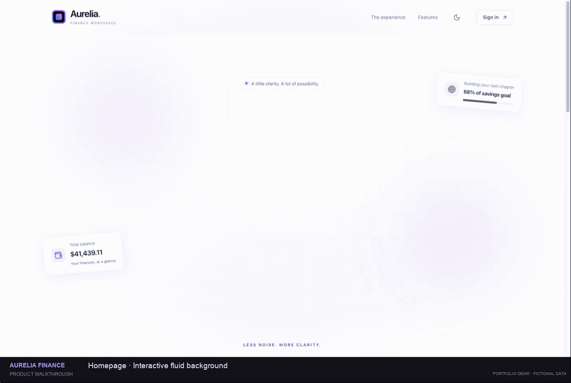

# Aurelia Finance

**Your money. A clearer perspective.**

An interactive finance workspace built with React and TypeScript. Designed as a portfolio project for demonstrating polished product design, responsive dashboards, accessible interactions, and useful frontend behavior.

All people, balances, accounts, and transactions are fictional. The app runs entirely in the browser and needs no backend, API keys, or bank connection.

## Product walkthrough

A 35-second screen recording of the interactive homepage, light/dark themes, demo sign-in, and the complete finance workspace: overview, transaction search, accounts and cards, budgets, and settings.

[](docs/media/aurelia-walkthrough.mp4)

**[Watch or download the full MP4](https://github.com/iamzhangjinpeng/aurelia-finance-demo/raw/refs/heads/main/docs/media/aurelia-walkthrough.mp4)** · 35 seconds · 1.5 MB · H.264 · No audio

Recorded from the running app with fictional data. The preview loops automatically; click it to open the full recording.

Screenshots: [Light dashboard](docs/images/dashboard-light.png) · [Dark dashboard](docs/images/dashboard-dark.png) · [Homepage](docs/images/landing.png)

## Explore the demo

| Email                  | Password       |
| ---------------------- | -------------- |
| `demo@aurelia.finance` | `Aurelia2026!` |

Open the homepage, choose **Explore the demo**, then use **Fill demo credentials** and sign in.

### What you can try

- **Landing page:** pointer-responsive WebGL fluid backgrounds, entrance and scroll-reveal animations, gradient branding, workspace preview, product features, and a clear demo entry point.
- **Overview:** settled balances, monthly income and expenses, interactive cash-flow charts, spending breakdown, and CSV export.
- **Transactions:** combined text/category/status filters, sorting, pagination, transaction details, and filtered CSV download.
- **Accounts & cards:** sample checking and reserve accounts, virtual card creation, freeze/unfreeze controls, and editable spending limits.
- **Budgets:** create, rename, edit limits, and delete budget categories with confirmation.
- **Settings:** editable profile, saved preferences, session details, and a confirmed reset of all demo data.
- **Across the app:** light/dark themes, mobile navigation, collapsible sidebar, keyboard-friendly forms, focus-trapped dialogs, and reduced-motion support.

Changes are saved in `localStorage`. Sign-in uses `sessionStorage`, and signing out preserves your workspace changes. Use **Settings → Reset demo data** to restore the original sample.

## Run locally

Requires Node.js 22.12 or newer and npm.

```bash
npm ci
npm run dev
```

Vite prints the local address. To use a specific port:

```bash
npm run dev -- --port 5188
```

## Verify

```bash
npm test
npm run build
npm run format:check
```

`npm run preview` serves the production build. GitHub Actions runs tests and a production build for pushes and pull requests.

The tests cover settled-funds calculations, pending/declined exclusion, combined search filters, reference lookup, and CSV escaping.

## Tech stack

| Layer   | Technology                                                   |
| ------- | ------------------------------------------------------------ |
| UI      | React 19 + TypeScript                                        |
| Build   | Vite                                                         |
| Routing | React Router                                                 |
| Charts  | Recharts                                                     |
| Icons   | Lucide React                                                 |
| Styling | CSS custom properties, responsive layouts, light/dark themes |
| State   | React Context + browser storage                              |
| Checks  | TypeScript + Vitest + Prettier                               |

The visual system uses blue/purple gradients, thin-line icons, subtle borders, card-based layouts, an orbital login illustration, and a responsive console shell. The interface is implemented in React, with no Vue runtime or production-service dependencies.

## Project structure

```text
src/
  App.tsx                  Route definitions and lazy loading
  components/
    Workspace.tsx          Sidebar, topbar, mobile navigation, and sign-out
    ThemeButton.tsx        Persistent light/dark theme
    UI.tsx                 Shared dialogs, branding, and UI helpers
  pages/                   Landing, login, overview, transactions, cards, budgets, settings
  lib/
    data.ts                Typed fictional data, filtering, calculations, and CSV output
    store.tsx              Demo state, persistence, and session management
  styles.css               Design tokens, components, and responsive styles
tests/
  data.test.ts             Business logic checks
```

## Data model

The sample uses an October 2026 snapshot. Account totals include only completed transactions; pending and declined transactions do not affect settled balances. The checking and reserve balances sum to the workspace balance.

Cash-flow history and forecasts, budget activity, card spending, and the savings goal are separate illustrative datasets. Editing one does not simulate a full banking ledger. Sample merchant names identify fictional demo transactions and do not imply affiliation.

## Deploy

This is a static single-page application. Build with `npm run build` and serve `dist/`.

- **Vercel:** import the repository, select the Vite preset, and deploy. `vercel.json` handles client-side routes.
- **Netlify:** use `npm run build` and publish `dist`. The included `_redirects` file handles client-side routes.
- **Other static hosts:** rewrite application paths such as `/app/transactions` to `/index.html`, while serving assets normally.

Deploy at the domain root. GitHub Pages subdirectory hosting requires configuring Vite's base path and the router basename first.

## Demo boundaries

The fixed account is a client-side presentation gate, not production authentication. There is no payment processing, bank integration, real email delivery, server, analytics, or remote financial API. Do not use this application to store real financial or personal information.
